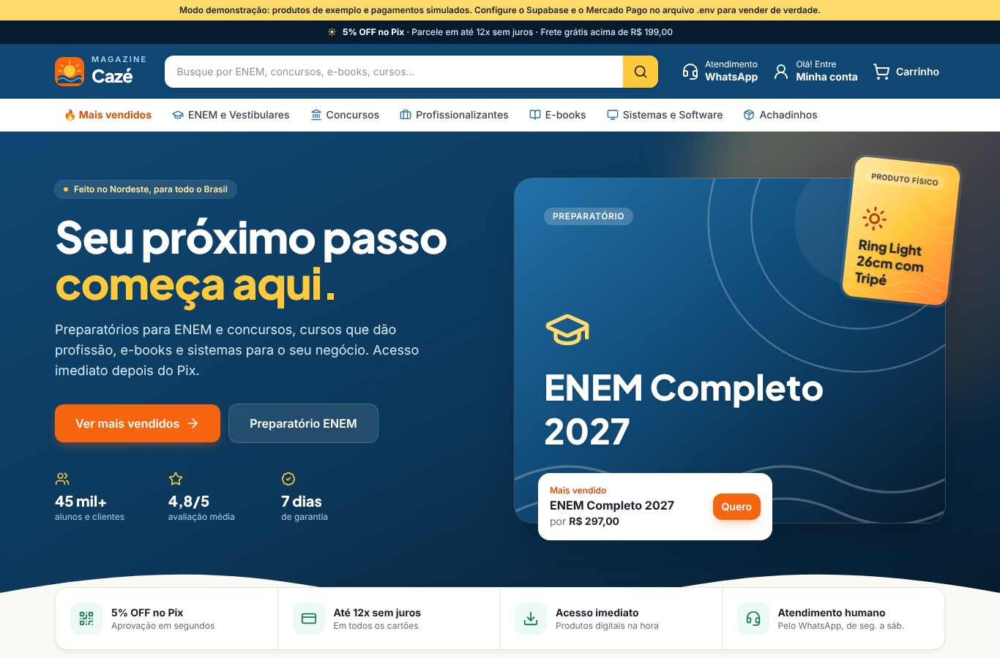

# Magazine Cazé 🌅

Loja virtual da Magazine Cazé, com preparatórios (ENEM e concursos), cursos profissionalizantes, e-books, sistemas e produtos físicos (dropshipping).



**Stack:** Next.js 16 (App Router) · TypeScript · Tailwind CSS v4 · Supabase (Postgres, Auth, Storage) · Mercado Pago (Pix + cartão em até 12x) · Vercel.

## Rodando localmente

```bash
npm ci
npm run dev
```

Abra http://localhost:3000. **Sem variáveis de ambiente, a loja roda em modo demonstração:** catálogo de exemplo, pedidos em memória e pagamento simulado (há o botão "Simular pagamento aprovado").

## O que já funciona (MVP)

| Área | Rotas |
|---|---|
| Vitrine | `/` (destaque, categorias, mais vendidos, banners, novidades, depoimentos) |
| Catálogo | `/produtos`, `/categoria/[slug]`, com busca (`?q=`), filtros por formato e preço, e ordenação |
| Produto | `/produto/[slug]` (preço, Pix, parcelas, ficha técnica, garantia, relacionados, JSON-LD para o Google) |
| Carrinho | `/carrinho` (salvo no navegador; itens digitais têm quantidade 1) |
| Checkout | `/checkout` (dados, endereço com busca de CEP só para físicos, Pix ou cartão) |
| Pedido | `/pedido/[id]` (QR Code Pix, contagem regressiva, atualização automática, downloads) |
| Conta | `/entrar`, `/conta` (meus produtos e meus pedidos) |
| Admin | `/admin` (indicadores), `/admin/pedidos`, `/admin/produtos` (cadastro e edição) |
| Institucional | `/ajuda/*` (sobre, termos, privacidade, trocas, entrega digital), `sitemap.xml`, `robots.txt` |

### API

- `POST /api/checkout`: valida os dados com zod, **recalcula preços no servidor**, cria o pedido e o pagamento.
- `POST /api/webhooks/mercadopago`: valida a assinatura, consulta o pagamento no Mercado Pago e confirma o pedido de forma idempotente.
- `GET /api/pedidos/[id]`: status do pedido (usado pela página do Pix).
- `GET /api/download/[productId]?pedido=`: entrega protegida (link assinado de 2 minutos ou redirecionamento para a área do aluno).

## Configuração e validação

Use Node.js 24 LTS para rodar o projeto e os testes de ambiente (`npm run test:env`).

Na Vercel, `VERCEL_ENV=production` exige as seis variáveis do `.env.example` durante o build e na inicialização. Fora da Vercel, configure `APP_ENV=production` nos dois momentos. As URLs precisam usar HTTPS em produção. Erros informam apenas os nomes das variáveis.

Sem credenciais, o modo demonstração usa catálogo fictício e pedidos em memória. Para testar o banco local sem um gateway, use Supabase na própria máquina (localhost, 127.0.0.1 ou ::1). Um banco remoto exige token e segredo do Mercado Pago. Nunca use o projeto de produção para testes.

Veja as instruções de [ambientes, migrações e CI](docs/AMBIENTES-E-CI.md) para configurar o Supabase local e rodar os testes.

## Colocando para vender de verdade

1. **Supabase:** crie um projeto, rode `supabase/migrations/0001_init.sql` e, se quiser, `supabase/seed.sql` no SQL Editor.
2. **Torne-se admin:** crie sua conta em `/entrar` e rode no SQL Editor:
   ```sql
   update profiles set role = 'admin' where id = (select id from auth.users where email = 'seu@email.com');
   ```
3. **Arquivos digitais:** envie os PDFs e instaladores para o bucket privado `digital` e preencha o campo "Entrega digital" do produto (ex.: `ebooks/renda-extra.pdf`). Para cursos, use a URL da área do aluno.
4. **Mercado Pago:** pegue o Access Token e configure o webhook apontando para `https://SEU-DOMINIO/api/webhooks/mercadopago` (evento: Pagamentos). Copie a assinatura secreta.
5. **Variáveis:** copie `.env.example` para `.env.local` (ou para as variáveis da Vercel) e preencha.
6. **Deploy:** importe o repositório na Vercel.

## Estrutura

```
src/
  app/                 rotas (páginas, API, admin)
  components/
    ui/                design system (botões, selos, preço, avaliação, campos)
    layout/            cabeçalho, rodapé, logo, busca
    home/ product/ cart/ checkout/ order/ account/ admin/
  lib/
    catalog/           tipos, catálogo de exemplo, repositório (Supabase ou demonstração)
    orders/            pedidos (Supabase ou memória)
    payments/          Mercado Pago, provedor simulado e gerador de BR Code
    supabase/          clientes (navegador, servidor e service role)
  store/cart.ts        carrinho (zustand + localStorage)
supabase/              migrações SQL com RLS e seed
docs/DESIGN.md         paleta, tipografia e padrões de conversão
```

## Rumo à produção
O roteiro completo para operar com 5 mil produtos em todo o Brasil está em [`docs/PROMPT-PRODUCAO.md`](docs/PROMPT-PRODUCAO.md).

O diagnóstico inicial e os pontos de revisão de cada entrega estão em [`docs/EXECUCAO-POR-FASES.md`](docs/EXECUCAO-POR-FASES.md). O diagnóstico (0A) e a atualização de dependências e validação do ambiente (0B) estão disponíveis para revisão.

## Próximos passos sugeridos
- E-mail transacional (Resend) com confirmação e links de acesso.
- Nota fiscal automática (NFS-e e NF-e) via Focus NFe ou eNotas.
- Frete por CEP (Melhor Envio) e integração com fornecedores de dropshipping.
- Cupons, programa de afiliados e recuperação de carrinho (WhatsApp).
- Avaliações reais de clientes e busca com Meilisearch.
- Marca d'água com o nome e o CPF do comprador nos PDFs.

> ⚠️ Produtos, avaliações e depoimentos atuais são **exemplos**. Substitua tudo pelos dados reais antes de publicar, e revise os textos legais com um(a) advogado(a).
